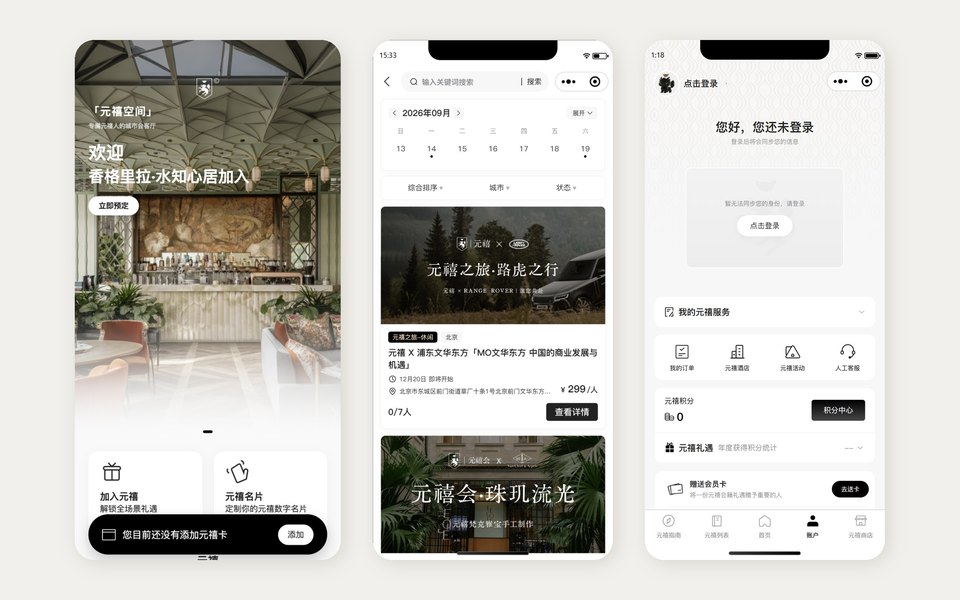
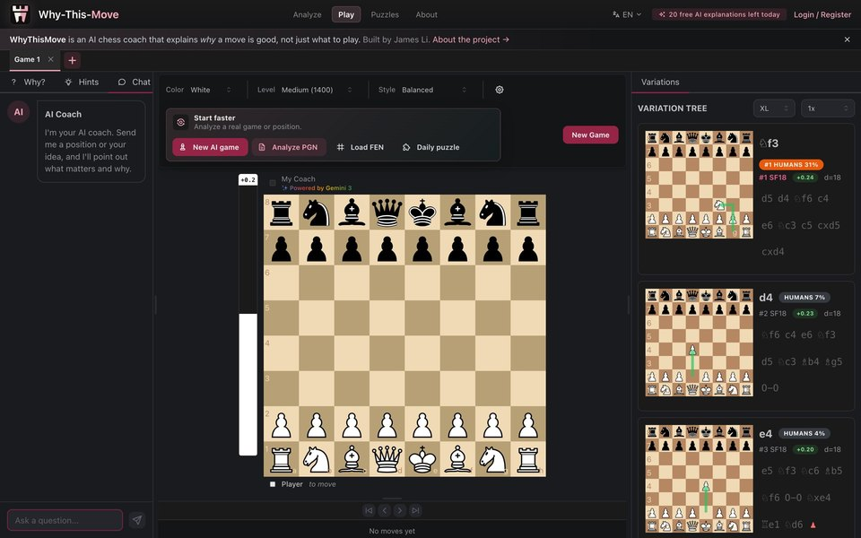
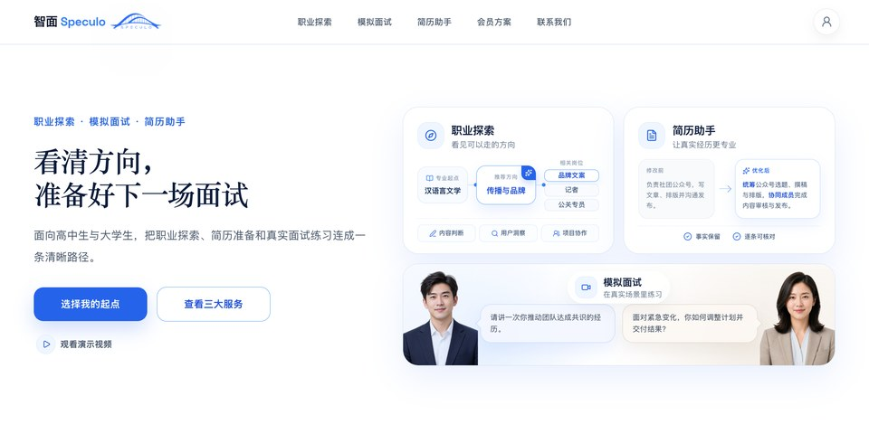
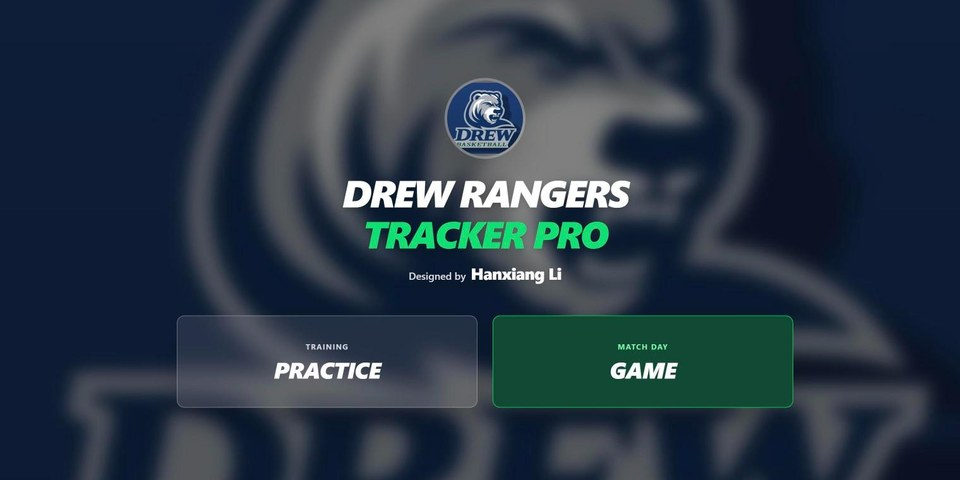

  

  

  
  
  

I build AI products end to end: the model pipeline, the back end, the client, and the deploy. Most of my commits right now go to YuanMil OS, where I am CTO. Much of that code is private, so every project below links to the running product.

## 🚀 What I'm shipping

<table>
  <tr>
    <td width="50%" valign="top">
      
      <h3>YuanMil OS</h3>
      
Members-only hospitality platform: a WeChat Mini Program, an iOS app, and operations consoles on a Spring Boot back end with WeChat Pay and an AI concierge. I own the architecture and the releases.

      

        
        
        
      

    </td>
    <td width="50%" valign="top">
      
      <h3>WhyThisMove</h3>
      
An AI chess coach that explains why a move was a mistake instead of only showing the engine line. Stockfish plus a human-move model, on a 1.2 TB Lichess opening database.

      

        
        
      

    </td>
  </tr>
  <tr>
    <td width="50%" valign="top">
      
      <h3>Zhimian</h3>
      
An AI mock-interview platform: real-time interview sessions over WebSocket, a retrieval-backed help assistant, and an admin console.

      

        
        
      

    </td>
    <td width="50%" valign="top">
      
      <h3>Drew Rangers Tracker Pro</h3>
      
The substitution and rotation app a college basketball coaching staff has used in games since March 2026. Game clock, rotations, injuries, and PDF practice reports.

      

        
        
      

    </td>
  </tr>
</table>

**Also building**

- 🔬 **DiscoveryHub**: LLM retrieval that matches pharmaceutical R&D interests to university patents. LoRA fine-tuned embeddings and a reranker lifted top-10 retrieval from 52.3% to 68.0%.
- 🏀 **Basketball mini-games**: two HTML5 games on TapTap and Hupu, a career simulation and a refereeing game built on FIBA rules.

## 💬 Happy to compare notes on

- Shipping one uni-app codebase to both a WeChat Mini Program and the App Store
- WeChat Pay in production: split payments, commission ledgers, and withdrawals
- Fine-tuning embedding and reranker models for retrieval, and measuring whether it helped
- Serving chess analysis from a 1.2 TB opening database without a big server bill
- Running a product as the only engineer: CI/CD, releases, and what to leave unbuilt

Building something nearby, or want a second pair of eyes on an idea? Email me.

## 🛠 Toolbox

  

## 📈 Activity

  <picture>
    <source media="(prefers-color-scheme: dark)" srcset="https://streak-stats.demolab.com/?user=hanxiangli666&hide_border=true&background=0D1117&ring=2F81F7&fire=06B6D4&currStreakNum=E6EDF3&sideNums=E6EDF3&currStreakLabel=2F81F7&sideLabels=E6EDF3&dates=8B949E&stroke=30363D" />
    
  </picture>

  <picture>
    <source media="(prefers-color-scheme: dark)" srcset="https://github-readme-activity-graph.vercel.app/graph?username=hanxiangli666&hide_border=true&area=true&bg_color=0D1117&color=2F81F7&line=2F81F7&point=E6EDF3&area_color=2F81F7&title_color=E6EDF3" />
    
  </picture>

